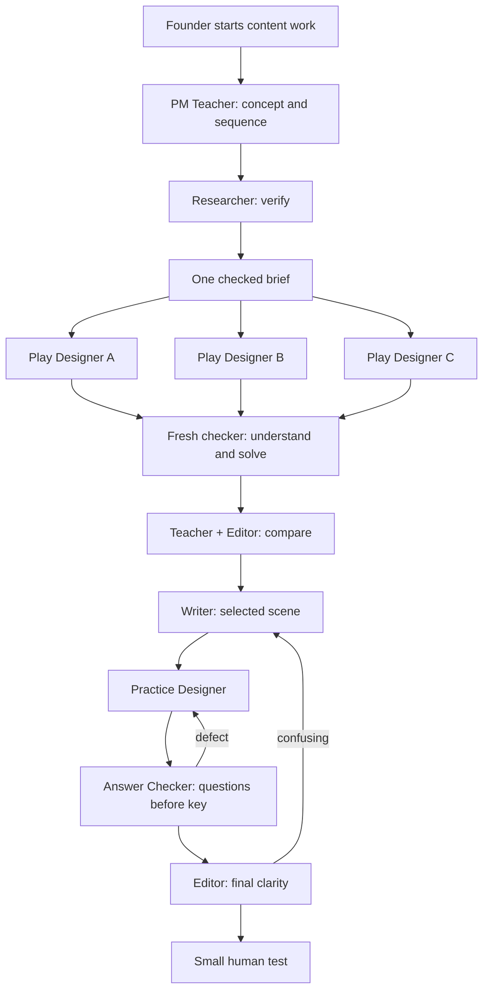

# Untangle content team

Status: **team setup only; content creation is on hold at the founder’s request.** When content work resumes, the PM Teacher will propose and explain the course sequence. Jobs to Be Done and North Star metrics are candidate topics, not a fixed order.

## Who does what

| Agent | Job |
|---|---|
| PM Teacher | Decide what to teach, why it matters, sequence and depth |
| Researcher | Verify evidence and catch unsupported claims |
| Play Designer A | Independently propose a game for the shared lesson goal |
| Play Designer B | Same brief; independent game proposal |
| Play Designer C | Same brief; independent game proposal |
| Scenario Writer | Turn chosen play into concise scenes and dialogue |
| Practice Designer | Build questions and targeted recovery after mistakes |
| Answer Checker | Solve independently; check rules and answers |
| Learning Editor | Catch confusing, shallow or disconnected teaching |
| Coordinator | Run handoffs, preserve corrections, resolve defects |

These are roles dispatched as separate workers when needed. They do not all run at once; current tool capacity permits three workers plus coordinator. No background automation or trained custom model is implied.

Start with: “Use $untangle-content-team for [topic or task].” Relevant PM subject skills are loaded by Teacher as needed; each skill is not another permanent agent. Designer independence applies to creative proposals; all share the same teaching goal and prior corrections.

Installed roles: `untangle-content-team`, `untangle-pm-teacher`, `untangle-play-designer`, `untangle-practice-designer` in `/Users/rohithpaull/.codex/skills/`. Source notices for adapted play design remain with that skill.

No new animation, deployment, growth, social-media or general business agents are needed for this content stage. Existing approved lesson opening remains locked. Runtime adaptive practice and Convex integration are future implementation work, not supplied by these authoring skills.

## Ready means

Role instructions, handoffs, inherited corrections and separate review rules are installed. Workers run on request in stages. This does not mean a course has been written, a new teaching workflow has passed an end-to-end trial, or learners have found it fun. No chapter, storyboard or prototype is being built during setup.

Full role instructions: [/Users/rohithpaull/.codex/skills/untangle-content-team/references/roles.md](/Users/rohithpaull/.codex/skills/untangle-content-team/references/roles.md). Every role has a full working contract; Designers A/B/C share the same contract but run separately.
