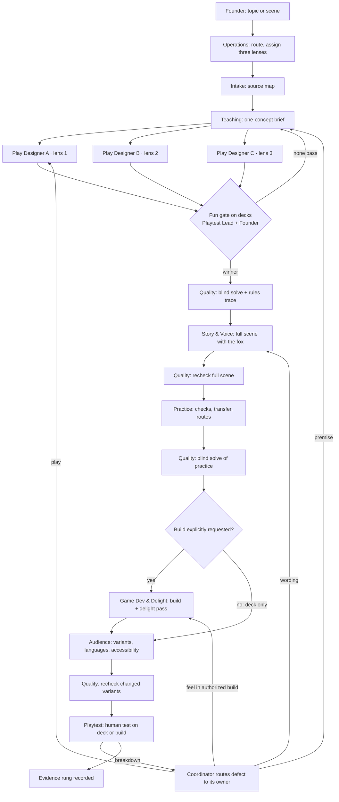

# Untangle content team (v2)

Status: Draft. Learning Studio reactivated on 8 October 2026 for the founder-approved prisoner’s-dilemma story direction. Current run and role assignments: [prisoners-dilemma-2026-10-08/manifest.md](prisoners-dilemma-2026-10-08/manifest.md). The earlier pause and next-job assignment are superseded for this run. Candidate decks still require play review; story approval is not evidence of learning or permission to replace the locked opening.

## How it works

The Learning Studio runs eleven teams in waves; the coordinator launches at most three workers at a time and workers do not spawn sub-teams. Teams collaborate through artifacts with shared IDs, not chat. Candidate play is judged before exhaustive answer checks; premise verification comes first.

## Current assignment — 8 October 2026

The [team review](prisoners-dilemma-2026-10-08/team-review.md) found no uncovered responsibility requiring a new role. Reuse the existing company with sharper handoffs: Teacher owns the causal explanation; Learning Scientist checks the changed-condition application; Play Designers own meaningful controls; Game Director owns independent opponent states; Playtest Lead rejects obvious-answer worksheets. Motion and Delight follow a selected interaction, not a weak premise.

Current deliverable: three independently designed playable drafts of the approved robbery/Ravi story, then a recorded founder selection. Read the [run record](prisoners-dilemma-2026-10-08/manifest.md) for actual workers, checks, and pending steps. Later Writer, Quality, Practice, Motion, Engineering and human-test roles are assignments to activate at the appropriate stage, not claims that they already ran.

## Who does what

| Seat | Studio team | Untangle notes |
|---|---|---|
| Coordinator | Operations | Pause rules, founder corrections into REJECTED and CHANGELOG, locked opening |
| Teacher + Learning Scientist | Teaching | `untangle-teacher`; subject notes for game theory and PM |
| Researcher | Intake | Source boundaries; no citations in learner copy |
| Play Designer A/B/C | Play | `untangle-play-designer`; fox deck template; different lens each |
| Playtest Lead, Test Facilitator, Measurement Analyst | Playtest & Measurement | Founder plays every gate; protocols in pm-pilot and play-openings |
| Scenario Writer, Character Lead | Story & Voice | `VOICE.md`, `CHARACTER.md` |
| Practice Designer | Practice | `untangle-practice-designer` |
| Answer, Rules, Continuity Checkers | Quality | Locked nodes byte-identical; REJECTED rows cited |
| Game Director, Delight Designer, Prototype Engineer | Game Development & Delight | `PRODUCT.md`, `GUIDED-JOURNEY.md`; prototypes only on instruction |
| Audience Profiler, Localizer, Accessibility Lead | Audience | Kannada, Tamil and other Indian-language drafts may use the Sarvam tools locally; native review required |
| Art Director, Motion Designer | Art & Motion | Fox-first hierarchy; motion that explains; review on builds |

Full contracts: `/Users/rohithpaull/.codex/skills/learning-studio/references/roles/`. Team charters: `/Users/rohithpaull/.codex/skills/learning-studio/references/teams/`.

## Ready means

Role contracts, handoffs, lens assignment, the fun gate, the deck tooling and the status words are in place and verified (links resolve, decks render and pass the checker). It does not mean a lesson has been produced by this team, that the pipeline has passed an end-to-end trial, or that any person has found the result fun. Zero human tests so far.
