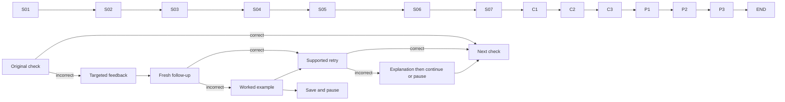

# Fewer signups. A better result?

Script proposal · One fictional workplace chapter · No app changes or human testing

## Presentation and rules (author-only)

Keep the learner in one role: the person leading a shared-task app team, preparing its launch update. The chapter concerns day-seven task completion, not revenue, profit, total value, or a verdict on the product. All numbers and colleagues are invented. Keep citations in sources.md.

One compact fox, one immediate prompt, one supporting visual. A committed action replaces the current view with its consequence; never append a transcript. Keep the same launch cards and calendar visible across the transition. Exact dialogue is quoted below; production directions are not learner copy. Reduced motion uses numbered still states with the same final labels. Nothing depends on colour or catching animation. No timers. The fox points to each launch while its fraction scales (S02), traces the missing calendar dates (S04), and holds both changed inputs in view (S06). Keep both hands attached and proportions consistent; no idle jiggle.

Metric convention: signup date is day 0; day 7 is the whole calendar date seven dates later, in the app's fixed reporting timezone. A return is at least one completed task on that date. Count each person once, however many tasks they complete. Tracking is complete through the displayed report date. The first two groups each signed up on one date, so everyone in a group has the same day-seven date. Their dates are fully observed. Do not mix this calendar convention with elapsed 24-hour intervals.

## Main story

### S01 — The launch update

**Show:** A team-update draft with two small cards: “Previous launch · 1,000 signups” and “Current launch · 200 signups.” No rates or return counts yet.

**Fox:** “You lead a task app. Signups fell from 1,000 to 200. But your team wants people to keep using it. Which launch do you think brought back a bigger share of its signups?”

**Choices, unscored:** A “Previous launch” / B “Current launch” / C “I can't tell yet.”

**Replacement response:**
- A: “You picked the previous launch. Let's see how many of each launch's signups returned.”
- B: “You picked the current launch. Let's see how many of each launch's signups returned.”
- C: “You're holding off. Let's see how many of each launch's signups returned.”

All three reveal the same task icon and day-seven marker. No correctness cue or invented explanation of the learner's motives. Button **“Open the return report” → S02**.

### S02 — Build the comparison

**Fox:** “Here, returning means completing a task exactly seven calendar days after signup. Each person counts once. Both launches have had their full day seven.”

**Show under that same message:** Previous: signed up 7 September; day seven 14 September; 80 people returned. Current: signed up 21 September; day seven 28 September; 40 people returned. Report through 4 October; tracking complete. Signup counts from S01 remain on their cards.

**Task:** “Place each signup count under its return count.”

Two fraction slots: Previous `80 / [ ]`; Current `40 / [ ]`. Movable labels **1,000** and **200**. Tap-label/tap-slot is an alternative to dragging. Each label can be used once. **“Compare out of 100”** becomes active after both slots are filled.

**Response rules:**
- Previous 1,000, Current 200: “You kept each launch with its own signups. Now we can compare equal-sized groups.”
- Previous 200, Current 1,000: “You paired 80 with 200 and 40 with 1,000. Those signups belong to the other launches. Keep each return count with the people it came from.” Return each label along a visible line to its own launch, then seat it in the correct denominator. This is teaching, not a scored failure or retry trap.

**Visible consequence, both routes:** Show the original fractions, then scale the two whole bars to equal width marked **“For every 100 signups.”** Previous bar fills 8 of 100 cells; Current fills 20. Original counts remain as small labels; do not show actual people vanishing or switching groups.

**Fox:** “Eighty out of a thousand is eight out of a hundred. Forty out of two hundred is twenty out of a hundred.”

Below the finished bars: **Previous: 8% · Current: 20%**. Button **“Use this in the update” → S03**.

### S03 — The first sentence

**Show:** The report draft now contains: “The current launch had fewer day-seven returners, but a higher day-seven return rate: 20% versus 8%.” Highlight 40 versus 80, then 20% versus 8%; highlight moves between two explicitly different measures.

**Fox:** “Fewer people came back in total. A bigger share came back from the smaller launch.”

**Concept card, after the visible comparison:** **Cohort retention** — “A cohort is a group that started together. Retention tells us how many came back, out of everyone who started. Here, we count task completion on day seven.”

**Fox:** “This answers our return-rate question. It doesn't tell us which launch earned more money.”

Button **“Check the newest group” → S04**.

### S04 — A zero that isn't a result

**Show:** A third signup card joins the same report: “Newest group · signed up 1 October · 100 people.” Its day-seven cell says **“0%”**. Calendar rests at **4 October**, and a visible rule says “Day 0 = signup date; day 7 = seven calendar dates later.”

**Fox:** “The team added Thursday's signups to your report. It's 4 October. Move the calendar marker to this group's day seven before you keep that zero.”

**Action:** Calendar offers date buttons 1–8 October; tap a date and **“Check this date.”**

**Branches:**
- 8 October: “You marked 8 October. We haven't reached it. This group's result is still pending.”
- 1–7 October: “You marked [selected date]. Signup day is day zero. Seven dates after 1 October is 8 October.” The marker counts 0 through 7 across the dated cells, ending at 8 October. “We haven't reached it. This group's result is still pending.”

**Consequence:** Grey future dates 5–8 remain visibly beyond the report cutoff. The zero is struck through once and replaced with **“Pending · full day seven ends 8 October.”** The two mature groups retain their rates. Button **“Keep the report fair” → S05**.

### S05 — Time to qualify

**Fox:** “These people haven't had their day seven. A blank result means we must wait. It doesn't mean nobody will return.”

**Concept card:** **Observation window** — “The stretch of time we can see. To compare day-seven retention, each included group must have a complete day seven.”

**Show:** The newest group moves to a visibly separate “Waiting for day seven” row. Its signups remain 100; no people or data are deleted. A date note appears: “Check after 8 October ends and its data is complete.”

**Fox:** “We'll compare it when the same window is complete.”

Button **“Finish the team update” → S06**.

### S06 — What changed besides the number?

**Show:** Back at the same report draft, a colleague's proposed sentence: **“Our shorter setup caused the better return rate.”** Under it, reveal two short launch rows, with no causal arrows:

| | Previous launch | Current launch |
|---|---|---|
| Setup | Five steps | Two steps |
| Invitations | Public signup link | Invited existing customers |
| Day-seven rate | 8% | 20% |

**Fox:** “Your team shortened setup. It also invited a different audience. Edit this sentence before it goes into your update.”

**Action:** Select the span replacing “Our shorter setup caused”: A **“Shorter setup caused”** / B **“Different invitations caused”** / C **“We observed”**. Sentence remainder: **“the better return rate.”** Button **“Preview my update.”** This is an unscored claim revision; nothing is sent.

**Replacement feedback:**
- A: “You credited shorter setup. But the invitations changed too. These results don't separate the two.”
- B: “You credited different invitations. But setup changed too. These results don't separate the two.”
- C: “You kept the observation. Both setup and invitations changed, so the cause is still open.”

**Visual consequence:** Highlight each changed input in turn. Both routes remain separate question-mark paths toward the observed difference; never animate either as a proven causal path. Replace the draft with **“We observed a higher day-seven return rate. We changed both setup and invitations, so we don't yet know why.”**

Button **“Keep the careful wording” → S07**.

### S07 — A clue, not a cause

**Fox:** “The shorter setup came with a higher return rate. That gives us a question to test, not a cause we've proved.”

**Concept card:** **Correlation is not causation** — “Two things can change together without one being shown to cause the other.”

**Show:** The final draft contains three short lines, assembled from the actual story actions:
1. “Current launch: 20% returned on day seven; previous launch: 8%.”
2. “Newest group: pending until its day-seven data is complete.”
3. “The rate improved in these groups. We haven't isolated the cause.”

**Fox:** “At work, ask: out of whom, by when, and what else changed?”

Buttons **“Check what I learned” → C1** / **“Pause here” → save S07 consequence and exit**. This is a genuine stopping point. Return restores this view.

## Closing questions

These are scored understanding checks, after all three concepts have been taught. Prefix each submitted response with **“Correct.”** or **“Not quite.”** using the reviewed key. This verdict appears with the authored explanation, never as an unexplained banner. Apply the same rule to P and R items; discovery scenes stay unscored. For each, show the prompt and compact evidence together. No answer appears before submission. Choose one option, then press **“Check my answer.”** Options may be changed before submission. Feedback always replaces the question; the assessment controller below supplies exact next routes. Do not infer a learner's motive from an option.

### C1 — Share or headcount?

**Fox:** “You review two signup groups for a notes app. Everyone has a complete day seven. A return means saving a note that day. Which group had the higher return rate?”

**Evidence:** Earlier: 600 signed up, 90 returned. Later: 200 signed up, 50 returned. Each person counted once.

**Options:** A “Earlier group” / B “Later group” / C “Same rate.”

**After A:** “Earlier had more returners in total. Its rate was 90 out of 600: 15%. Later was 50 out of 200: 25%.”
**After B:** “Later was 50 out of 200: 25%. Earlier was 90 out of 600: 15%.”
**After C:** “The rates differ: earlier was 15%, later was 25%. Compare each return count with its own signup count.”

### C2 — Has the result arrived?

**Fox:** “A booking app counts people who make a booking exactly seven calendar days after signup. Signup day is day zero. Today ends day three for its newest group. What belongs in that group's day-seven report?”

**Options:** A “0% returned” / B “Use its day-three rate” / C “Pending.”

**After A:** “Zero would report an observed day seven with no returners. This group hasn't reached day seven.”
**After B:** “Day three measures a different time. It cannot stand in for day seven.”
**After C:** “Pending keeps an unfinished window separate from a measured zero.”

### C3 — What does the evidence support?

**Fox:** “A file-sharing app changed its welcome email and switched from public ads to customer referrals. The next signup group had higher day-seven retention. Both groups have complete data. Which sentence can you support?”

**Options:** A “The email caused the increase” / B “The observed rate increased” / C “Referrals caused the increase.”

**After A:** “The email changed, but the audience changed too. These results don't isolate the email's effect.”
**After B:** “The rate increased in these groups. Because email and audience changed together, the cause remains open.”
**After C:** “Referrals changed, but the email changed too. These results don't isolate the referrals' effect.”

After C3 feedback and any correction loop, **“Start fresh practice” → P1**. Never announce mastery or unlock other chapters.

## Separate fresh practice

### P1 — Count people, not tasks

**Fox:** “Four hundred people signed up for your study app. On their fully observed day seven, 60 people completed 150 study sessions. A return means completing at least one session that day. What was day-seven retention?”

**Options:** A “15%” / B “37.5%” / C “40%.”

**After A:** “Sixty people returned out of 400 signups. That's 15%. Extra sessions don't create extra people.”
**After B:** “150 counts sessions. Retention counts people: 60 out of 400, or 15%.”
**After C:** “60 out of 150 compares people with sessions. Keep all 400 original signups underneath: 60 out of 400 is 15%.”

### P2 — A complete day matters

**Fox:** “Your newest signup group reaches calendar day seven today. It's noon, and 12 of its 100 people have completed a task. Older groups include their whole day seven. Can you compare today's 12% as a finished day-seven rate?”

**Options:** A “Yes; day seven has started” / B “No; replace it with 0%” / C “No; today's window is incomplete.”

**After A:** “Starting day seven isn't finishing it. More people can still qualify before today ends.”
**After B:** “Twelve people have already qualified, so zero would be false. Keep the result marked incomplete.”
**After C:** “Today hasn't ended. Mark 12% as incomplete and compare after the full day and its data are complete.”

### P3 — A different kind of comparison

**Fox:** “In one fully observed signup group, people who chose to finish a profile had higher day-seven retention than those who didn't. Should your report say finishing a profile caused them to return?”

**Options:** A “Yes; the groups show a difference” / B “No; they may differ in other ways” / C “No; profiles cannot affect returning.”

**After A:** “The difference is observed, but people chose whether to finish a profile. Existing motivation could affect both actions.”
**After B:** “People chose whether to finish a profile. Motivation could affect both completing it and returning. The cause isn't established.”
**After C:** “These results don't establish a cause. They also don't establish that profiles have no effect.”

## Targeted follow-ups and complete routing

Each original question has its own fresh follow-up below. Correct answers and misconception tags are in answer-key.md. Follow-ups use only taught rules.

**Controller for each original Q:** Correct → its authored feedback → **“Continue”** → next original question. Incorrect → its authored feedback → **“Try another example”** → Q's R item. On R, correct → authored response → **“Return to my question”** → original Q with answer cleared and first-attempt history retained. R incorrect → authored worked response → **“Return to my question”** or **“Pause here.”** Pause saves the worked response and resume destination. The returned Q is a supported retry. If that retry is incorrect, show its authored feedback and offer **“Continue with this explanation”** or **“Pause here”**; never loop to R again. Continue records **“Review suggested”** for that concept and advances. A correct supported retry records corrected practice, never independent success. All incorrect R responses below are worked examples, so no hidden extra explanation is required.

Sequence: C1 → C2 → C3 → P1 → P2 → P3 → END. Original C3's next-button label is “Start fresh practice”; other next buttons say “Continue.” Every pause restores the precise prompt or consequence, selections, attempts and next destination; no re-randomisation.

### R-C1 — Retention denominator

**Prompt:** “Two signup groups each have a complete day seven. Returning means completing a checklist that day, counted once per person. One group had 300 signups and 60 returners; the other had 100 signups and 30 returners. Which rate is higher?”
**Options:** A “300-person group” / B “100-person group.”
- A: “The first group had more returners, but 60 out of 300 is 20%. Thirty out of 100 is 30%. The 100-person group has the higher rate.”
- B: “Thirty out of 100 is 30%, above 60 out of 300: 20%.”
**Visual:** Both fractions become equal 100-unit bars labelled 20% and 30% after submission only.

### R-C2 — Not yet observed

**Prompt:** “An app measures day-seven task completion. A signup group's calendar has reached only day five. Should its final day-seven value be zero or pending?”
**Options:** A “Zero” / B “Pending.”
- A: “Day five comes before day seven. Their day seven hasn't happened; its result is pending, not zero.”
- B: “Day seven hasn't happened. Pending keeps that missing result separate from zero.”
**Visual:** Mark days 0–5 observed and 6–7 future after submission.

### R-C3 — Two changes

**Prompt:** “A team's reminder message changed in the same week its signups switched from students to office workers. Retention rose. Do these results isolate the message's effect?”
**Options:** A “Yes” / B “No.”
- A: “Both message and audience changed. The rise doesn't tell us which change caused it, or whether another factor did. The message's effect isn't isolated.”
- B: “The message and audience changed together. The results don't isolate the message's effect.”
**Visual:** Keep both changes visible above one measured increase; no proven causal arrows.

### R-P1 — People versus activity

**Prompt:** “A reading app has 200 signups. On their fully observed day seven, 30 people save 90 passages. Returning means saving at least one passage. Is retention 15% or 45%?”
**Options:** A “15%” / B “45%.”
- A: “Thirty people out of 200 signups is 15%. Count each person once.”
- B: “90 is passages. Only 30 people returned. Thirty out of 200 is 15%, however many passages they saved.”
**Visual:** One person marker may connect to several passage icons, but contributes only one count; then show 30/200 = 15%.

### R-P2 — Partial-day trap

**Prompt:** “A signup group's day-seven date is 15 November. It's 9 a.m. on 15 November. Is that group's whole day seven observed?”
**Options:** A “Yes” / B “No.”
- A: “Only the morning has arrived. People can still return later today. The whole day-seven window isn't observed yet.”
- B: “People still have the rest of 15 November to qualify. The whole day isn't observed.”
**Visual:** A 24-hour band fills only through 9 a.m.; label the rest “Not yet observed.”

### R-P3 — A link doesn't settle the cause

**Prompt:** “People who voluntarily join an app's tutorial return more often. Could existing enthusiasm explain both joining and returning?”
**Options:** A “Yes” / B “No.”
- A: “Yes. Existing enthusiasm is a possible shared reason. This doesn't prove that explanation; it shows why the tutorial's effect is still uncertain.”
- B: “Existing enthusiasm could make someone both join and return. Because that's possible, this comparison alone doesn't prove the tutorial caused returning.”
**Visual:** After submission, show “Possible existing enthusiasm” linked by dotted, explicitly possible paths to both actions. Do not assert it was measured.

### END — A useful report

**Fox:** “You checked the share, the time window, and the claim about cause. Those three checks make a launch report easier to trust.”

**Show:** Three concept labels with actual attempt status: “Answered independently,” “Corrected with support,” or “Review suggested.” Never “Mastered.” Unattempted work stays “Not attempted.” A concept has two originals; show both results separately rather than silently collapsing them to one status.

Buttons **“Review my report” → S07** / **“Finish for now” → save END and exit**. Review does not erase attempts. No app-install, payment, or production chapter-unlock promise in this pilot.

## Route diagram

## Corrections applied (author-only)

- Role before arithmetic; one stable workplace job; response acknowledged before new facts: S01–S02.
- Surprise is unscored; no hidden-rule grading or invented learner motive: S01.
- Concrete counts, denominator, action and window precede calculation: S02.
- Approved baseline's direct calculation voice, without changing locked content: S02, “Eighty out of a thousand…”
- Visuals explain the operation and missing time; no decorative movement or false transfer of people: S02, S04–S05.
- Three distinct main activities: construct a comparison, locate a date, revise a claim. No “what shall we test first?” lesson-navigation choice.
- Name comes after mechanism, and correct discovery still receives teaching: S03, S05, S07.
- No unjustified commercial or causal verdict: S03, S06–S07, C3, P3.
- Every branch replaces the view and preserves the story objects; concise prompt plus necessary evidence, not one tap per sentence.
- Separate closing checks, fresh practice, targeted reviewed follow-ups, finite repeated-error route and exact resume: C1–END.
- Sources remain internal; fictional evidence is labelled; human comprehension and engagement remain untested.

Pacing: the main route uses 11 committed answer/submit/next presses through starting C1, plus four construction selections: two denominator placements, one calendar date, and one sentence span. The six originals add 12 submit/next presses and six answer selections. The no-error route reaches END in 33 interactions using drag placement, or 35 with tap-label/tap-slot placement; “Finish for now” adds one. Pauses and correction routes add only their specified actions. Incorrect main construction does not add a retry loop. These are authored interaction counts, not an implemented timing or engagement test.
