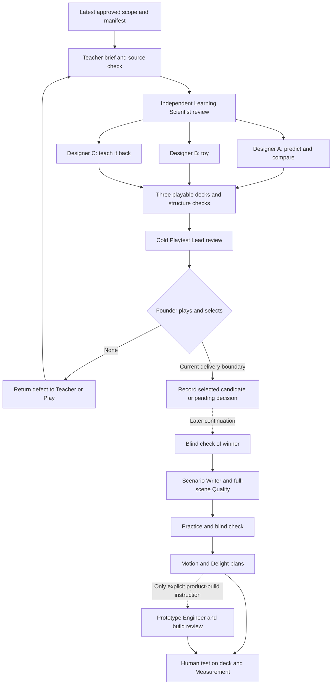

# Team review — robbery, Ravi, and the café

Status: Draft. Read-only staffing and responsibility review, 8 October 2026; no candidate decks or human play results reviewed.

## Decision

Keep the existing team. No new role contract is needed. The nine inspected roles already cover subject accuracy, learning, playable decisions, story, review, motion, delight and evidence. The gap is a precise handoff: who makes the conflict discoverable, who rejects a shallow explanation, and who protects opponent independence. More reviewers would not fix those gaps.

The latest founder direction in the staging manifest authorizes this standalone lesson and the team setup. It supersedes the older content pause and JTBD next-job for this run. Approved story direction is not approval of these proposed assignments or finished decks. This review changes neither shared skills nor the existing app or locked opening.

## What needs tightening

| Risk | Why it matters here | Owner and required correction |
|---|---|---|
| An obvious first choice | Given only the goal of fewer own prison years, confessing is better under both Ravi choices. Pretending the mathematical options are equally good would corrupt the lesson. | Teacher owns the comparison; Play owns the experience. Leave the first move unscored. The interesting problem is why each person's improvement can leave both worse off, not guessing the designer's preferred button. Do not label silence foolish or confessing morally correct. |
| Explanation repeats the result | “Both confessed, so both got three years” does not explain the dilemma. | Teacher requires the two fixed-opponent comparisons, mirrored for Ravi, plus the joint comparison. Scenario Writer makes those visible through the same objects. Playtest rejects a concept card that merely renames an outcome. |
| Surprise is manufactured | Making Ravi betray the learner whatever they choose proves nothing about incentives. | Game Director owns the state rule; every designer implements it. Ravi's authored scenario choice is fixed independently of the learner's current action. A replay changes only its explicitly identified variable. Reveal the deal before commitment. |
| Outcome is treated as destiny | The model predicts incentives under a stated objective; real people may value loyalty or behave differently. | Teacher states the fewer-own-years assumption and treats confess/confess as an illustrative joint outcome. Do not invent Ravi's thoughts, a probability of betrayal, or claim all humans must confess. |
| Café is called full transfer | The approved café numbers preserve the prison game's strategic structure. New nouns and maximising money instead of minimising years do not change which type of action wins. | Learning Scientist labels it fresh application and checks reasoning. Record the studio's changed-condition requirement as unmet unless a separately reviewed condition actually changes the answer. Do not force a wrong second move, alter the approved numbers, or claim transferred learning. |
| Animation pretends to explain invented economics | The café payoffs are authored daily profits, not a derived customer model. | Motion Designer shows clearly labelled profit changes. Do not fabricate customer counts, sales, costs or legal facts to justify fixed payoffs. |

Relevant rejected-pattern rows: “Prudent-versus-careless options”; “Obvious advice in plain words”; “Grading an uninformed guess on a hidden rule”; “Payoff explained before the move”; “Same example with new nouns called transfer”; “Forced actions dressed as decisions”; “Quiz format replaces play; answers echo the stem”; “Explaining a change that is not shown”; “Decorative motion”; “Claiming fun, engagement or retention from an AI review.” Disclosing the rule does not require giving the conclusion away: show the sentence offer, let the learner commit and compare, then explain the pattern.

## Assignments and acceptance

These are seats and handoffs, not nine simultaneous workers. The coordinator runs at most three workers at once. Current scope stops at reviewed candidates and the founder gate. Later work below is a prepared assignment, not permission to expand a winner or alter the app.

| Seat | Ownership and deliverable | Acceptance criterion |
|---|---|---|
| Subject Teacher | Own `brief.md`: one action-based objective, two verified payoff tables, assumptions, allowed claims, misconception and minimum explanation. | A learner can explain why changing only their own choice can help them while both making that individually attractive choice hurts both compared with mutual silence. Compare 0 with 1 and 3 with 5 for you; mirror for Ravi; compare 3/3 with 1/1. Explain that changing one person's choice from 3/3 is not the same as both changing together. No second named concept required. |
| Learning Scientist | Independently review the Teacher brief in its learning-design section, before designers receive it. Own the distinction between a prediction, a strategy choice and evidence of learning. | No opening choice is diagnosed as a misconception on its own. The brief identifies the inference the learner must make; café application requires explaining both fixed-rival cases and the shared outcome, not word matching. Explicitly flag the unresolved changed-condition gate. |
| Play Designers A/B/C | Each owns one independent `script.md`, `learner-only.md` and `deck.html`, using a distinct lens and the same approved brief. | All first-choice branches acknowledged; before/change/after visible; every payoff reconciles; scenario opponent cannot react to a hidden choice; every opening route reaches a consequence within 12 taps; deck checker passes and browser branch checks are recorded. No inspection of competing designs. |
| Game Director | Coordinator may wear this seat for a short state/loop section in the manifest; a separate hire or worker is unnecessary. Own permissible state changes and the meaningful-decision count. | Distinguish real commitment, hypothetical replay and perspective change on screen. The learner controls their own action in a run, not Ravi. Inspect each deck for action → consequence → comparison → explanation → café application. No reward layer, course map, or progression expansion. |
| Scenario Writer | After a winner is selected and blind-checked, usually the winning designer continues into `scene.md`, learner-only decisions and updated deck. | Ravi introduced as the accomplice before his choice matters; robbery/capture/separation/deal have a clear bridge; every branch gets specific acknowledgment without mind-reading; explanation gives a causal contrast; concept name follows demonstrated mechanism; café role and daily-profit units are clear. |
| Playtest Lead | A fresh reviewer owns the cold `fun-gate.md`, receiving role, gate questions, scope and rendered decks only. Reads wider material only after recording the first pass. | Plays every branch, records first-consequence taps per route, gives evidence for all seven gate questions, identifies agent versus founder observations and recommends one or none. Cannot award a clean pass to a repeat-only second move. Founder selection is separate from the AI recommendation. |
| Motion Designer | After selection, specifies `motion-plan.md`; before selection, designers must already show readable consequences. Own causal movement, final stills and replay. | Sentence years remain attached to the correct person, comparisons clearly identify what changed, independent decisions do not appear reactive, reduced-motion states convey the same result. Timing claims require a deck/build/video actually inspected. No decorative motion as a remedy for shallow play. |
| Delight Designer | After selection, creates a moment map in `delight-pass.md`; deck work is planning, not a finished-build feel review. | Surprise is the individual-versus-shared conflict. Action is acknowledged immediately, the consequence settles before explanation, and the fox never celebrates betrayal or a wrong reasoning answer. Every proposed detail supports attention or understanding. Exact screen IDs, no vague “make it pop.” |
| Measurement Analyst | Own `evidence.md` and the next-test protocol, prepared after selected routes exist. | Log anonymous participant, candidate/version, screen, action, reason in their words, assistance, pauses and voluntary continuation. Separate opening choice, supported comparison and independent café reasoning. Human tests currently zero; no fun, retention or transfer result asserted. |

Existing Intake and Quality roles remain part of the pipeline: source/premise verification before design, independent blind answer/rules check of the winner after the play gate, and full-scene checks after later writing. Their full contracts were not audited here; no claim is made that this review replaces them.

## Three genuinely different design briefs

The coordinator can assign these without changing the approved story or outcomes. Each designer must name the exact borrowed reference beat in its script. These are directions, not three finished scripts.

- **A — Predict and compare.** Start with the unscored commitment, then ask the learner to predict a controlled replay with Ravi held fixed. Compare the learner's two possible actions before mirroring Ravi's incentives. Borrow the predict/observe/compare structure in the catalogue; do not introduce a reactive or learning opponent.
- **B — Toy.** Make the sentence deal tangible: the learner changes one own action in a clearly labelled what-if replay and sees the sentence records settle. Then switch to the other person's perspective under explicit labels. The payoff objects must carry the discovery, not an explanation panel. Borrow one-control/one-effect exploration; avoid four mandatory worksheet cells.
- **C — Teach it back.** Preserve the robbery and personal first move. Later, have the learner build an explanation for the fox, who traces exactly that claim against a fixed what-if case. The fox may apply the explanation, but Ravi's real decision never changes because the learner instructed him. Use concrete, equally plausible claims and visible consequences; no silent free-text grading or answer echoed by the prompt.

“Commit under others' moves” is available in the catalogue but is not the recommended third lens here: its usual response/reputation/credible-promise machinery could accidentally turn the approved one-shot model into another lesson. If selected instead, explicitly remove reactive-opponent and repeated-round mechanics.

## Staged responsibility map

The Game Director's state rule applies across all three candidates. Motion and Delight do not sit ahead of premise or play: they amplify a sound mechanism. Founder approval of the story already permits the present setup/deck work; no fresh authorization is needed to make the three candidates reviewable.

## Inspection and limits

Read in full: staging manifest; project AGENTS, PILLARS, REJECTED, TEAM and PATTERN-LIBRARY; Learning Studio SKILL and handbook; Untangle Content Team SKILL; all nine requested role contracts (Play Designer, Subject Teacher, Learning Scientist, Game Director, Scenario Writer, Playtest Lead, Motion Designer, Delight Designer, Measurement Analyst); studio fun, learning-science, fun-gate and status references. Inspected the studio lens catalogue entries used above. Read the relevant product direction and game-theory prisoner-dilemma guidance, including the distinction between independent what-if trials and reactive opponents. The combined long source read was truncated, so this is not an audit of the entire curriculum or product document. Older topic/chapter directions are not used to override the latest staging manifest.

No role execution, product edit, candidate selection, browser test or human test was performed in this team audit. Source factual verification is assigned to the separate Intake/Teacher work. No additional role file was created because there is no uncovered responsibility.

Next: accept the checked Teacher brief, resolve or explicitly preserve the café transfer limitation, then give three independent designers their separate lenses.
