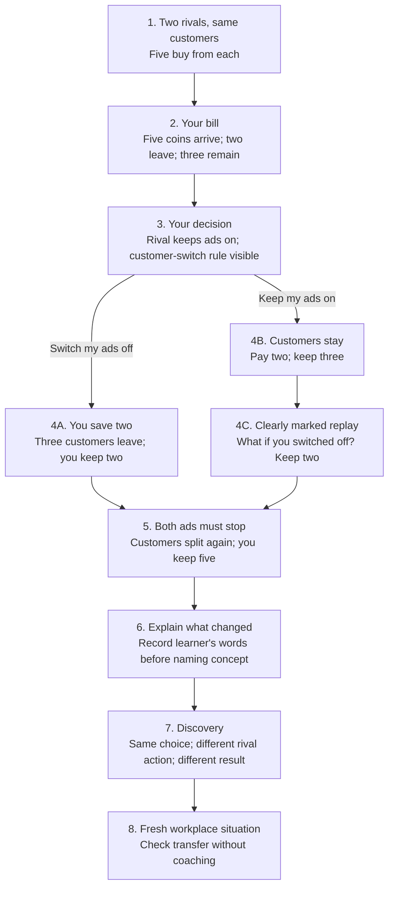

# One complete loop: The bill you cannot escape

Status: proposed storyboard, not approved content or a tested lesson. Prepared 5 October 2026. Current prototype unchanged.

## Purpose

Teach strategic interdependence: the result of your choice depends on what someone else does. Preserve the advertising mystery, but isolate one small, explicitly invented market. This is not a historical reconstruction of cigarette sales. The historical case remains outside this comprehension test; it must later receive its own accurate bridge.

The original 100/40/60 ledger is replaced here with ten customers and a two-coin ad bill. This is a proposed simplification, not a change to the production curriculum. A customer brings one coin; no other costs exist in this miniature game. If both advertise, customers split five each. If only one advertises, three customers switch to it, giving an eight/two split. If neither advertises, customers split five each. These rules are authored, not real-world estimates. No scored prediction uses an undisclosed rule.

## Visual storyboard

This diagram is an author overview. A new tester sees only the learner deck, one frame at a time. They do not receive this document or the answer guide.

## Frame 1 — who and why

Fox: **“You both pay for ads. Neither gets ahead.”**

Scene: Blue company labelled **You**, purple company labelled **Your rival**. Each has five customers. Both ads are on. Supporting line: **“You sell the same product to these ten customers.”** No coins or formulas yet.

Action: **“Follow my money”**. This is an orientation action, not a fake strategic decision.

Motion plan: introduce the companies together, then distribute the ten customers. Hold the final state. The fox looks between the two equal groups. No looping jiggle.

## Frame 2 — one baseline

Fox: **“Five customers. Five coins. Two go on ads. You keep three.”**

Scene: Preserve both companies. Enlarge only the player's cash tray. Five customer coins enter; two leave toward the ad; three remain. Label **“You keep 3”**. Show the small persistent rule **“1 customer = 1 coin · Ads cost 2”**. Do not display rival finances.

Action: **“Can I stop paying?”**

Motion plan: money arrives, cost leaves, balance settles. Separate these events; do not animate all totals at once. Static storyboard shows the three states as a short strip.

## Frame 3 — fair choice

Fox: **“Your rival is keeping its ads on. Will you keep yours?”**

Visible rule, next to the customer diagram: **“If only one company advertises, three customers switch to it.”** The three customers that can move are outlined. The current state remains five each, both ads on, player keeps three.

Choices:
- **“Keep my ads · Pay 2”**
- **“Switch mine off · Pay 0”**

The learner controls their own advertising only. No score or correctness verdict. The goal is to keep more coins. Both buttons are clear actions, although the supplied rule makes keeping ads the financially better move here. This is a guided introductory decision, not a difficult strategy puzzle. Do not claim its difficulty or novelty will sustain a whole chapter.

## Frame 4A — if they switch off

Fox first: **“Your ad bill is gone.”**

Visual event: player's ad goes dark; the cost marker disappears. Then three of the player's customers cross to the rival. Their payments follow them. No coins travel directly between company tills.

Fox after movement: **“But three customers left too. You keep two coins.”**

Static result: **“Before: 3 → Now: 2”**, with the same two remaining customers above the two coins. Optional **Replay**. No green/red grading panel.

Action: **“Then both ads stop”**.

## Frame 4B — if they keep ads

Fox: **“You kept your five customers. After the ad bill, you keep three coins.”**

Visual event: five coins arrive, two pay for ads, three remain. No invented customer loss.

Action: **“What if I switched off?”**

## Frame 4C — counterfactual, only after 4B

A small **Replay: your other choice** label prevents rewriting the player's actual decision.

Fox: **“Switch yours off, and three customers go to your rival. You keep two.”**

Show exactly the same causal sequence as 4A. This is an alternative to the previous round, not another day or accumulated losses. Do not say the learner switched off when they did not.

Action: **“Then both ads stop”**.

## Frame 5 — change one condition

Fox: **“Now a rule stops BOTH companies' ads.”**

Scene: Begin from the off/on comparison with two/eight customers. The rival's ad goes dark. Player's ad stays off. Show **“Neither advertises → five customers each”** before the next outcome. This is the final disclosed rule of the miniature market, not a claim about real consumers.

Motion plan: three customers return to the player; their coins follow; no ad cost leaves. Display **“You keep 5”**. Keep the customer's path visible as a still-state arrow for reduced motion or missed animation.

Fox after movement: **“Your ads are still off. But your rival no longer has the only ad.”**

Action: **“What changed?”**

No extra prediction here. The player has one meaningful advertising choice; this event resolves the dilemma. Do not split each animation beat into a separate Continue screen.

## Frame 6 — test explanation before supplying it

Present two snapshots: **Only yours off → keep 2**; **Both off → keep 5**. Player's off switch visually identical in both. Highlight rival switch difference, not a new ledger.

Prompt: **“Your ads were off both times. Why did you keep more money the second time?”**

Capture a free-text or spoken answer. No model answer, hint, or grading visible before submission. The learner may say they do not know. Do not force an MCQ that supplies the causal explanation.

## Frame 7 — discovery

Fox: **“Switching off alone cost you customers. Switching off together removed the rival's ad advantage.”**

Then: **Strategic interdependence**

Definition: **“Your result depends on your choice AND someone else's choice.”**

Practical question: **“Before changing your move, ask: what will the other person do?”**

The review deck uses an authored explanation, not AI assessment. Do not claim the explanation is personalized. Future tested feedback can distinguish ad-cost confusion from competitor-effect confusion.

## Frame 8 — fresh transfer check

“A meeting starts at 3. You arrive at 3. One day everyone else arrives at 3; another day they arrive at 3:20. What changes for you even though you made the same choice?”

Free answer, no choices supplied. This deliberately uses no companies, money, or advertising. It checks the relationship, not whether the learner repeats our vocabulary. It is a comprehension probe, not a claim that this everyday example is sufficiently exciting to become the next lesson.

Final optional prompt: “Where did you first feel unsure?” Offer stop or replay without pressure.

## Internal review performed

- Arithmetic: both advertise 5−2=3 each; only player off 2−0=2, rival 8−2=6; both off 5−0=5 each. Ten customer coins conserved; ad bills are costs paid outside the companies.
- Branches: either initial choice reaches the same explicitly labelled off/on comparison before both-off event. Original choice is preserved in the test record.
- Information: switching rule disclosed before action. Neither-advertises rule disclosed before its result; no prediction scored against it.
- Role: player runs the blue company throughout. The both-off change is externally imposed, not something the player commands their competitor to do.
- Historical boundary: no claim that the toy model proves the cigarette paper. Historical interpretation is deliberately not part of this narrow test.
- Open concern: rules are clear but may feel contrived; the first decision is easy. Test whether clarity improves before claiming the hook is compelling. Reintroducing the historical opening later requires another test.
- Open concern: static boards cannot validate animation pacing or mascot emotion. Motion directions above remain specifications, not verified behavior.

## Internal source notes

Concept: supplied professor transcript, final discussion distinguishing isolated decisions from outcomes dependent on multiple players. Miniature market and all values: original teaching model. Cigarette case context: Mitchell and Mulherin supplied paper, not the source of these payoffs. Interaction approach: competitive-analysis.md, especially observed Evolution of Trust tutorial. No citations appear in learner screens.
